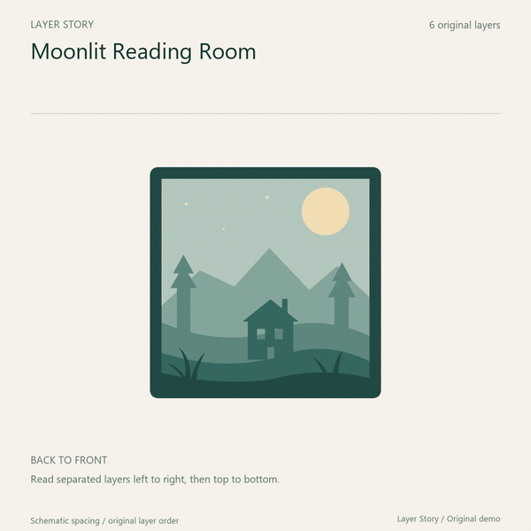
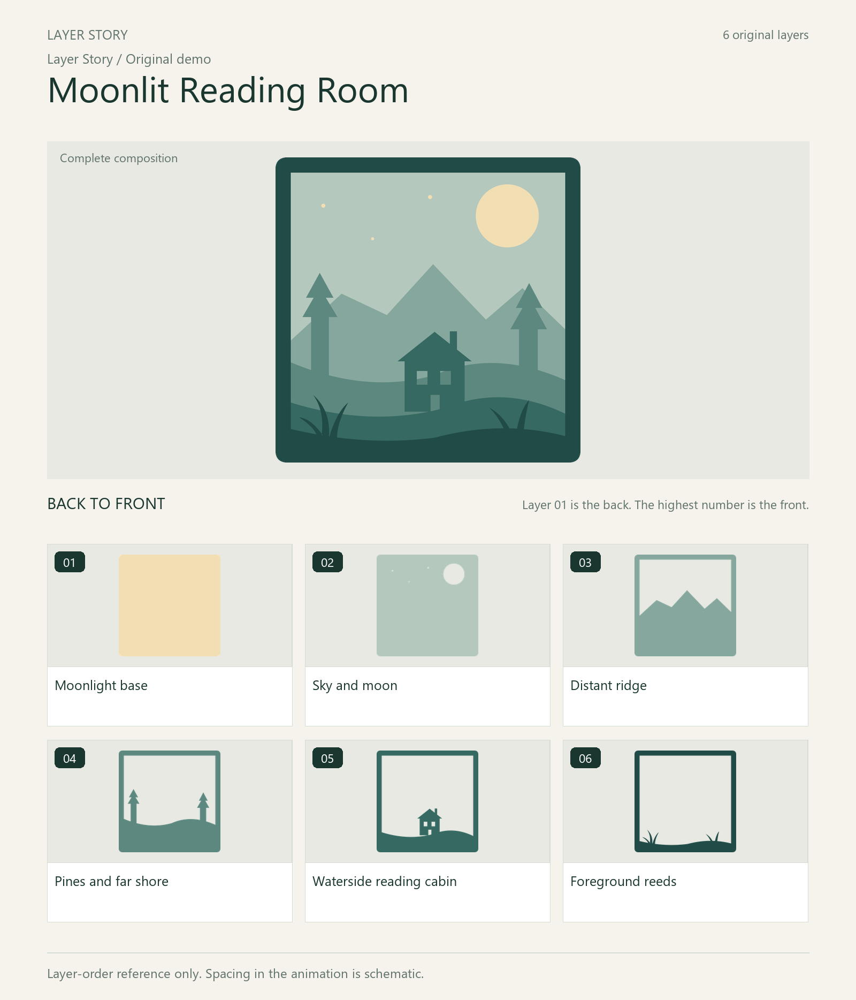

# Layer Story

Turn aligned SVG layers into a numbered guide and a short unfold-and-return video.

For designers of layered paper art, shadow boxes, and flat stacked artwork who already have separate, aligned source layers. The same layer identity and back-to-front order carry through the overview, PDF, individual images, and video.



[Watch the full MP4](docs/demo/layer-story.mp4) · [Read the sample PDF](docs/demo/layer-guide.pdf) · [View the overview](docs/demo/overview.png)

The included artwork is an original synthetic demonstration. It has not been physically cut or assembly-tested.

**中文简介：** 将作者已对齐、已确认前后顺序的独立 SVG 图层，生成中文或英文层序辨识图册、逐层图片，以及 12 秒展开／复位视频。保留原图颜色、孔洞与图层身份；切割拼板需先由作者提供组装后的对齐布局。[中文快速使用](#中文快速使用)

## What it produces

| Output | Purpose |
| --- | --- |
| `overview.png` | Complete composition and numbered layer index |
| `layer-guide.pdf` | Layer labels, each original layer beside its cumulative composition, and any author-supplied notes |
| `layer-story.mp4` | 12-second, 1080 × 1080, 24 fps H.264 video with a numbered grid held from 4–8 seconds |
| `layers/` and `cumulative/` | Transparent individual PNGs and successive composites |
| `composite.png` and `video-poster.png` | Final composition and video poster |
| JSON build records | Layer IDs, source SHA-256 hashes, output inventory, warnings, and presentation metadata |



The video preserves each complete layer canvas and aspect ratio, using translation and uniform scaling to unfold the stack into separate numbered cards. Its spacing is schematic. The first and last composited frames match before lossy video encoding.

## Start with the CLI

Requirements:

- Python 3.10 or newer, with Pillow, ReportLab, and imageio-ffmpeg.
- Node.js 20.9 or newer, with `sharp`.
- A readable, embeddable TrueType font covering your title, labels, and guide language.

Clone the repository and create a Python environment:

```sh
git clone https://github.com/eason560899/layer-story.git
cd layer-story
python -m venv .venv
```

Activate it with `source .venv/bin/activate` on macOS/Linux, or `.\.venv\Scripts\Activate.ps1` in Windows PowerShell. Then install the dependencies and run the English demo:

```sh
python -m pip install -r requirements.txt
npm install --ignore-scripts
python scripts/build_layer_story.py assets/demo/manifest.en.json --out demo-output
```

Open `demo-output/overview.png`, `demo-output/layer-guide.pdf`, and `demo-output/layer-story.mp4`. Use a new or empty output directory for each run; existing files are never overwritten. Add `--skip-video` to generate the images and PDF without encoding an MP4.

Dependency installation may download packages. Once the dependencies and fonts are available, the build runs locally without network access or artwork uploads. MP4 encoding uses the local FFmpeg executable supplied by imageio-ffmpeg; `IMAGEIO_FFMPEG_EXE` can point to another local executable.

If `sharp` is already installed in a shared Node runtime, its `node_modules` directory can be supplied through `NODE_PATH`. To use a font outside the usual system locations, set `LAYER_STORY_FONT` to a suitable embeddable TrueType font file. See [the manifest and environment reference](references/manifest.md) for details.

## Use with an agent

Layer Story includes a [`SKILL.md`](SKILL.md) with the input checks, build workflow, and visual review steps. You can point an agent directly at that file in your checkout.

In Codex, you can also ask the skill installer:

```text
$skill-installer Install Layer Story from https://github.com/eason560899/layer-story.
The skill is at the repository root.
```

Install the Node and Python dependencies from the installed skill directory using the setup above. Skill installation supplies the workflow and scripts; it does not bundle those runtimes. Codex detects installed skills automatically; restart it if the skill does not appear. See the [official Codex skills documentation](https://developers.openai.com/codex/skills/) for supported installation locations and other setup options.

Then give the agent your files and the facts it needs:

```text
Use $layer-story to create an English layer guide and presentation video.
My SVG files are aligned on the same canvas. I confirm the order from back
to front is: background, mountains, trees, cabin, foreground.
Use the project title "Moonlit Cabin" and brand "My Studio".
Keep the source artwork unchanged. Include only the assembly notes I supply.
```

For another agent, replace `$layer-story` with an explicit instruction to read the repository's `SKILL.md`. The agent should inspect the output images, PDF pages, and video states before handing over the results.

## Prepare your own artwork

Each SVG must represent **one physical layer defined by the author**, aligned on the same `viewBox`, including its origin. The manifest supports **2–24 layers**, listed **back to front**: layer 01 is at the back, and the highest number is at the front.

Confirm alignment and order from the author or trustworthy source metadata. A filename sort, path list, or shared color is not enough to establish physical layers.

Put a manifest beside your SVG files:

```json
{
  "title": "Moonlit Cabin",
  "brand": "My Studio",
  "language": "en",
  "order_confirmed": true,
  "alignment_confirmed": true,
  "layers": [
    {"id": "background", "label": "Background", "file": "01-background.svg"},
    {"id": "cabin", "label": "Cabin", "file": "02-cabin.svg", "note": "Author-supplied note, if available."}
  ]
}
```

Set the confirmation fields to `true` only after those facts have actually been checked. Paths resolve relative to the manifest. IDs must be unique lowercase slugs. Notes are optional and reproduced as supplied.

```sh
python scripts/build_layer_story.py /path/to/manifest.json --out /path/to/new-output
```

The renderer keeps supported fills, strokes, holes, transforms, internal references, and intentional white backgrounds. Each SVG renders as a separate document, so the same definition ID in two different source files stays independent. The original source files are not edited.

See [the full manifest reference](references/manifest.md) for SVG constraints, limits, and output details.

## Scope and input limits

- Cutting sheets with separately packed pieces need the author's assembled layout first. Automatic layout recovery is not implemented.
- Convert SVG text to outlines before export. External resources, embedded raster images, scripts, filters, and animated SVGs are unsupported and rejected.
- All layers must share the same finite `viewBox`. Each source SVG is limited to 5 MB.
- This is a layer-order reference and presentation tool. It does not infer adhesives, foam thickness, cutting settings, or unprovided assembly instructions.
- Output dimensions are for presentation. They are not 1:1 cutting templates or proof that an object can be manufactured or assembled.

## Validation status

The first release was checked with an original six-layer demo, a separate four-layer fixture, and a 24-layer long-label stress case. Checks covered holes, intentional white regions, local transforms, duplicate definition IDs across files, and two separate layers with the same color. Independent compositing matched every cumulative PNG in the four-layer fixture, and source hashes stayed unchanged.

The six- and four-layer videos were decoded and inspected through their closed, expanded, and returned states. The expanded view gives each layer its own numbered card. The 24-layer case was checked with a 27-page static PDF and video-renderer frames; it has not had a full independent MP4 decode check.

Missing order/alignment confirmation, missing files, duplicate layer IDs, external resources, SVG text, and mismatched canvases were exercised as rejection cases. These are bounded engineering checks, not exhaustive SVG compatibility, cross-platform installation, or physical cutting validation.

## 中文快速使用

先按上方 CLI 步骤安装依赖。中文图册需要可嵌入、且覆盖所用汉字的 TrueType 字体，例如合适的微软雅黑、黑体或 Noto Sans SC 字体文件；必要时通过 `LAYER_STORY_FONT` 指定路径。

```sh
python scripts/build_layer_story.py assets/demo/manifest.json --out demo-output-zh
```

处理自己的素材时，将清单的 `language` 设为 `zh`，填写作品名、品牌、图层标签和已有作者备注。清单顺序必须是**从后到前**，且每个 SVG 已在同一画布对齐。未提供的胶水、泡棉、厚度和具体装配工艺不会自动补写。

也可以直接向 Agent 说明：

```text
使用 $layer-story，把这些 SVG 做成中文层序辨识图册与展示视频。
所有文件已在同一画布对齐，我确认从后到前为：……。
品牌名为：……。没有提供的装配工艺不要添加。
```
